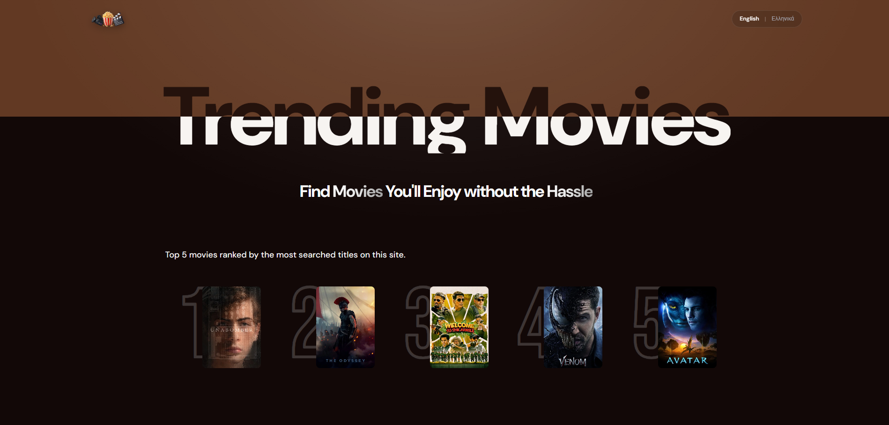
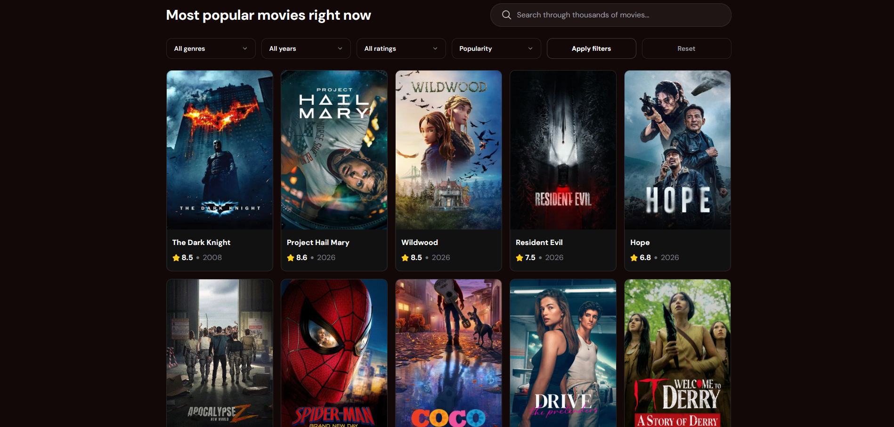
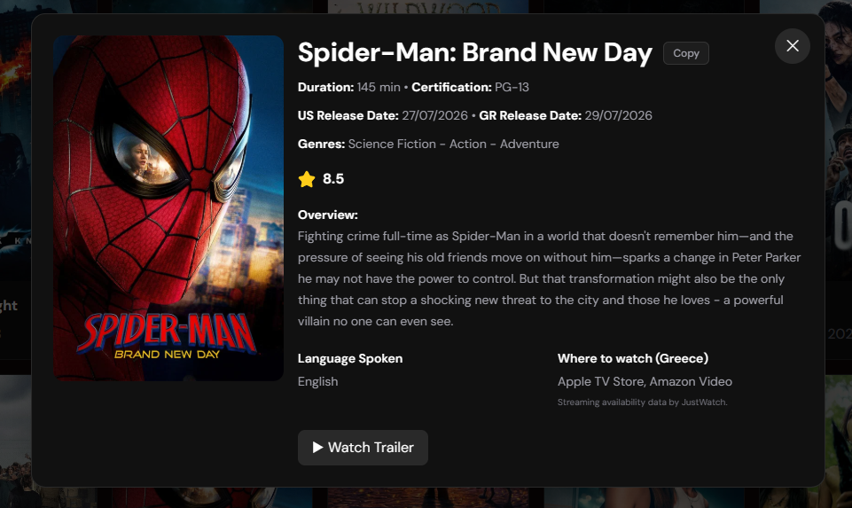

# Trending Movies

A modern and responsive movie discovery application built with React and Vite, powered by the TMDb API.

Users can discover movies, search for titles, filter results by genre, release year and rating, and explore detailed movie information. The application also integrates Appwrite to track search activity and display trending searches based on user interactions.

Built with a focus on responsive design, accessibility, and a smooth user experience.

### Homepage



### Movie Search & Filters



### Movie Details



## Features
 
- Search for movies with debounced input to reduce unnecessary API requests.
- Browse movies with genre, release year, rating, and sorting filters.
- Apply and reset filters independently of the search experience.
- Discover trending movie searches based on real user activity.
- Clear search input to return to browsing.

## Movie Details

Explore detailed movie information through an interactive modal, including:
- Runtime
- Genres
- Spoken languages
- Ratings
- Movie overview
- US and Greek (GR) release dates
- Content certification
- Available watch providers
- Trailer link when available

## Trending Searches & Appwrite

- Track movie search activity using Appwrite.
- Display trending movies based on user search activity.
- Handle unavailable trending data with a fallback interface.

## User Experience & Accessibility

- Responsive interface for desktop and mobile devices.
- English and Greek language support.
- Keyboard-friendly navigation with visible focus indicators.
- Accessible movie cards and modal interactions.
- Escape-to-close functionality and focus management.
- Improved labeling for icon-only controls.
- Loading and error states for a clearer user experience.
- Request cancellation to prevent outdated search results from updating the interface.

## Tech Stack

## Tech Stack

| Technology | Purpose |
|---|---|
| React | Component-based UI and state management |
| Vite | Development server and build tooling |
| TMDb API | Movie data and discovery |
| Appwrite | Search activity tracking and trending searches |
| Tailwind CSS | Responsive styling and UI design |
| react-i18next | English and Greek internationalization |
| react-use | Utility hooks, including debounced search |

Some of the main technical concepts implemented in this project include:

- Debounced Search: Delays search requests until the user stops typing, reducing unnecessary API calls.
- Request Cancellation: Uses AbortController to cancel outdated requests and prevent stale results.
- Dynamic Filtering: Combines multiple filter options to refine movie results.
- Third-Party Integration: Connects TMDb for movie data and Appwrite for tracking search activity.
- Internationalization: Implements English and Greek language support using react-i18next.
- Accessibility: Includes keyboard navigation, modal focus management, and accessible interactive elements.

## Getting Started

### 1. Clone the repository

```bash
git clone https://github.com/IKaramitsos/TrendingMovies.git
cd TrendingMovies
```

### 2. Install dependencies

```bash
npm install
```

### 3. Create your environment variables

Create a `.env.local` file in the root of the project and add:

```env
TMDB_ACCESS_TOKEN=your_tmdb_read_access_token
VITE_APPWRITE_PROJECT_ID=your_appwrite_project_id
VITE_APPWRITE_DATABASE_ID=your_appwrite_database_id
VITE_APPWRITE_TABLE_ID=your_appwrite_table_id
```

## Running the project

Start the development server:

```bash
npm run dev
```

## Accessibility and UX

This project includes:

- Keyboard-friendly navigation.
- Visible focus indicators for interactive elements.
- Accessible modal behavior with dialog semantics.
- Focus management when opening and closing the movie modal.
- Escape-to-close functionality.
- Improved labels for icon-only buttons.
- Appropriate alternative text for images.

## Lessons Learned

Building this project helped strengthen my understanding of:

- React component architecture and state management.
- Working with external APIs.
- Asynchronous data fetching and error handling.
- Debounced search and request cancellation.
- Filtering and sorting data.
- Integrating third-party services such as Appwrite.
- Tracking user activity and displaying trending content.
- Internationalization with react-i18next.
- Accessible modal interactions and keyboard navigation.
- Responsive design with Tailwind CSS.

## License

This project is for educational and portfolio purposes.
